# Active Directory – Domain Account Security

**Hands-on IT Support & Security Lab | November 24, 2026**

## Project overview

In this simulated enterprise environment, I provisioned a domain user and configured account-level security restrictions using Active Directory Users and Computers (ADUC). The goal was to provide a sales employee with appropriate access while limiting authentication to an authorized workstation and business hours.

This project supports CompTIA A+ Core 2 (220-1202) objectives 2.2 (Windows security settings) and 2.7 (workstation security and hardening).

## Lab environment

| Component | Purpose |
|---|---|
| DC | Domain controller, DNS and DHCP |
| MS | Member server hosting network applications |
| ADMIN | Administrative workstation |
| PC | Authorized client workstation |
| ADUC | Domain account administration |

All work was performed in a simulated training environment, not a production network.

## Work order

| Requirement | Configuration |
|---|---|
| User | Dakota |
| Organizational unit | Nonadmins |
| Security group | sec-glo-sales |
| Authorized workstation | PC only |
| Authorized logon hours | Monday–Friday, 8 AM–6 PM |
| Password | Lab-provided password (not published) |

## Implementation

### 1. Open Windows Administrative Tools

On the ADMIN workstation, open Start > Windows Administrative Tools and locate Active Directory Users and Computers.

**Why:** ADUC provides centralized administration of domain users, groups and computers.

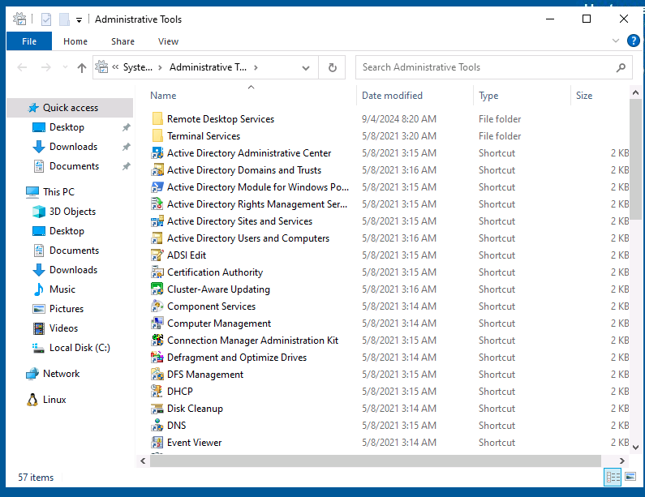

### 2. Locate the domain and organizational unit

Open ADUC, expand the domain and select Nonadmins.

**Why:** Organizational units organize directory objects and can support delegated administration and Group Policy. OU placement alone does not grant or deny administrative privileges.

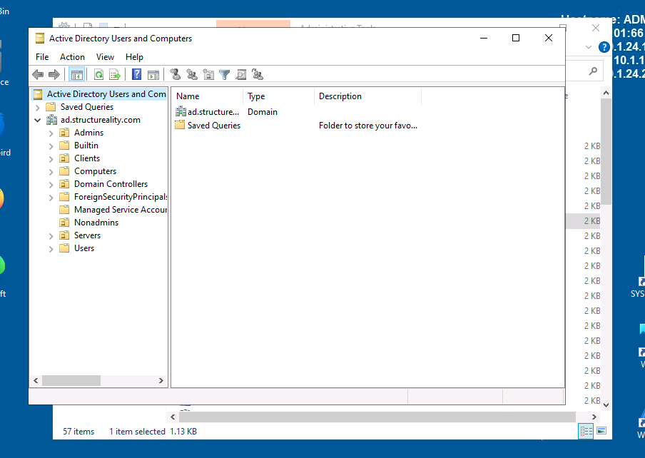

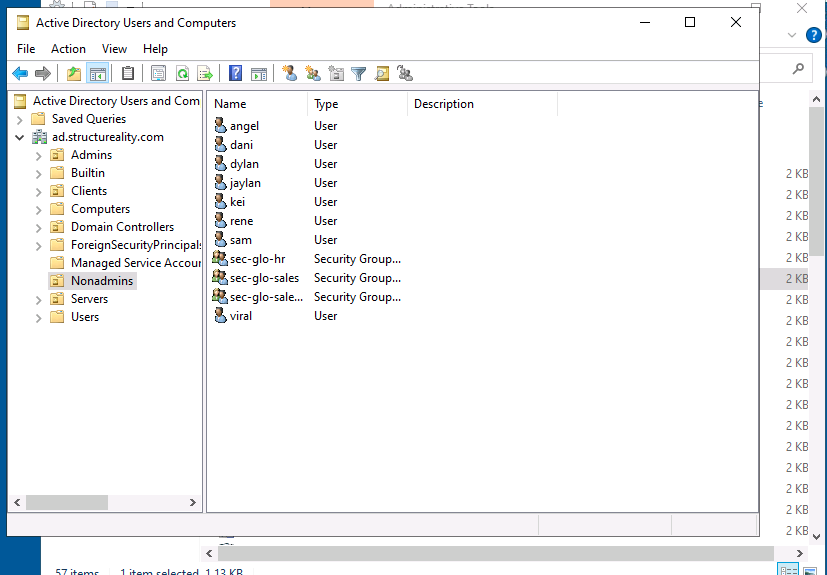

### 3. Create the domain user

Right-click Nonadmins > New > User. Enter Dakota as the first name and user logon name. Confirm the full name and continue.

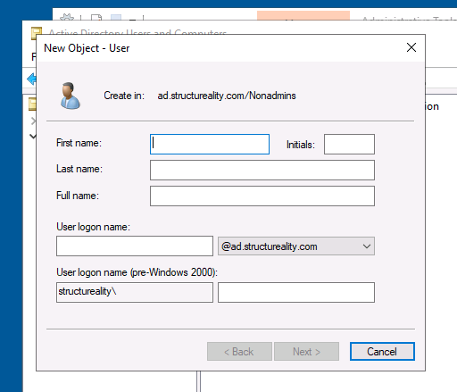

Enter and confirm the lab-provided password. Uncheck **User must change password at next logon**, as specifically required by this lab. Leave unrelated account options unchanged. Select Next, review the summary and select Finish.

**Why:** A unique domain identity enables centralized authentication and accountability. In production, follow the organization's password and onboarding policies rather than copying this lab exception.

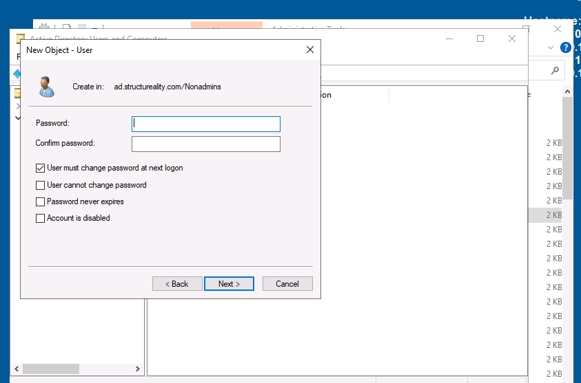

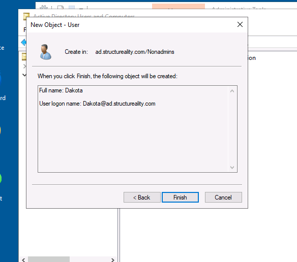

### 4. Assign the sales security group

Right-click Dakota > Add to a group. Enter `sec-glo-sales`. When multiple matching names appear, select the exact sales group, not `sec-glo-sales-managers`. Confirm the selection.

**Why:** Group-based authorization supports least privilege and simplifies permission administration. Actual resource access depends on permissions assigned to the group.

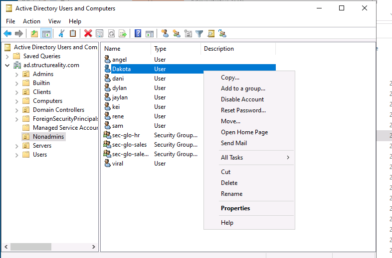

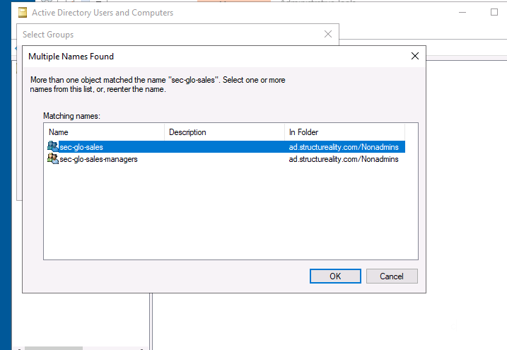

### 5. Verify group membership

Right-click Dakota > Properties > Member Of. Confirm that `Domain Users` and `sec-glo-sales` are listed.

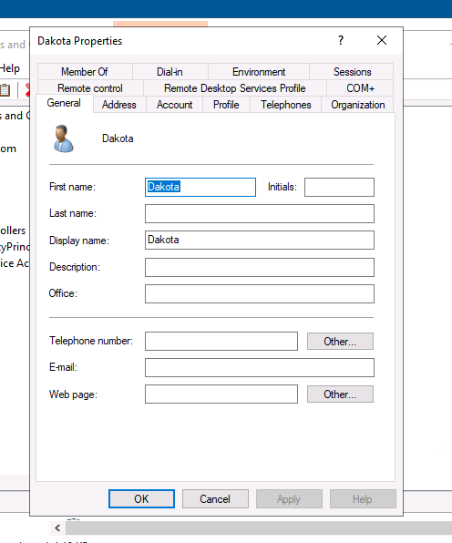

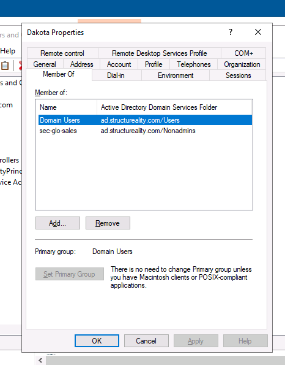

### 6. Restrict workstation access

In Dakota Properties, open Account > Log On To. Select **The following computers**, enter `PC`, select Add, then OK.

**Why:** Workstation restrictions limit where the user can authenticate through supported domain logon mechanisms, reducing unauthorized workstation use. They are not a universal network access control.

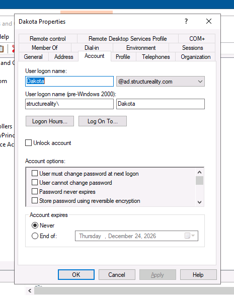

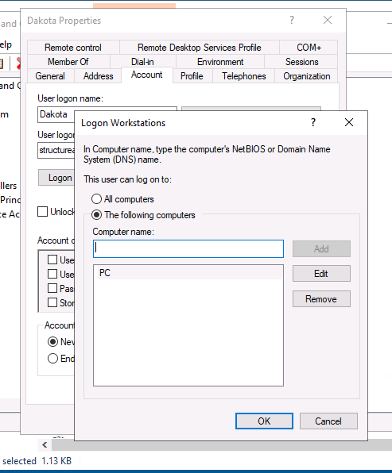

### 7. Configure logon hours

In the Account tab, select Logon Hours. The initial grid permits all hours. Select All, then Logon Denied. Highlight Monday through Friday, from 8 AM up to the 6 PM boundary, and select Logon Permitted.

**Why:** Time-based restrictions limit new domain logons outside approved business hours. Existing sessions are not necessarily terminated automatically.

**Before:** 168 hours per week permitted.

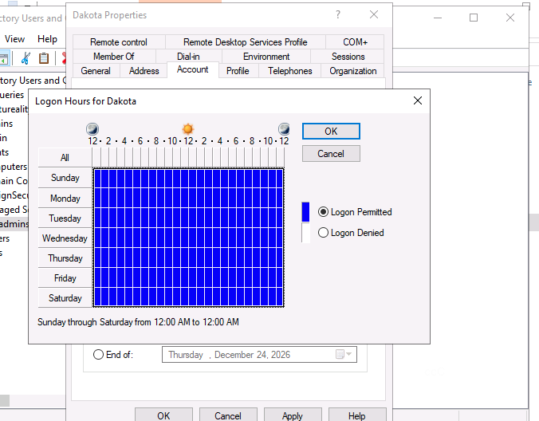

**After:** 50 hours per week permitted; 118 hours denied. The dialog explicitly displays Monday through Friday from 8:00 AM to 6:00 PM.

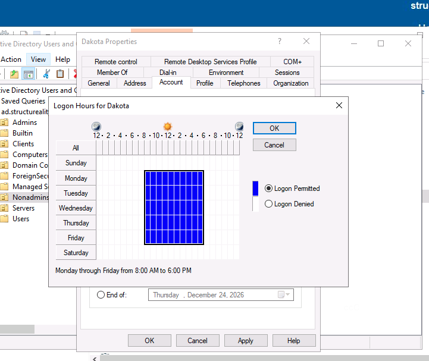

### 8. Save and validate (final verification pending)

Select OK in Logon Hours, then Apply and OK in Dakota Properties. Reopen the properties to verify the settings persisted. Run the lab's Evaluate function and record the result.

## Results and validation

| Control | Evidence status |
|---|---|
| Dakota created in Nonadmins | Confirmed by screenshot |
| Sales group membership | Confirmed by Member Of screenshot |
| PC-only restriction | Configuration shown in dialog |
| Business-hours restriction | Configuration shown in dialog |
| Saved settings after reopening | Not yet evidenced |
| Lab evaluation score | Not yet provided |
| Functional authentication testing | Not performed or evidenced |

Recommended functional tests, if authorized in the lab: verify logon from PC during business hours; verify denial from an unauthorized workstation; verify denial outside business hours. Do not change production system clocks to simulate these tests.

## Skills demonstrated

- Active Directory Domain Services administration
- Domain user provisioning and organizational unit navigation
- Security group membership and least-privilege principles
- Workstation and time-based logon restrictions
- Configuration verification and technical documentation
- Translating a help-desk work order into security settings

## Key takeaway

This lab demonstrates how identity and access management combines authentication with authorization and contextual restrictions. A valid password alone should not automatically entitle a user to unrestricted access. In a production environment, I would also follow change-control procedures, verify effective permissions, test the configuration, and document the outcome before closing the ticket.

## Documentation note

Screenshots are from a simulated training lab. No passwords are published. The final evaluation and functional test results are intentionally not claimed because they were not supplied.
